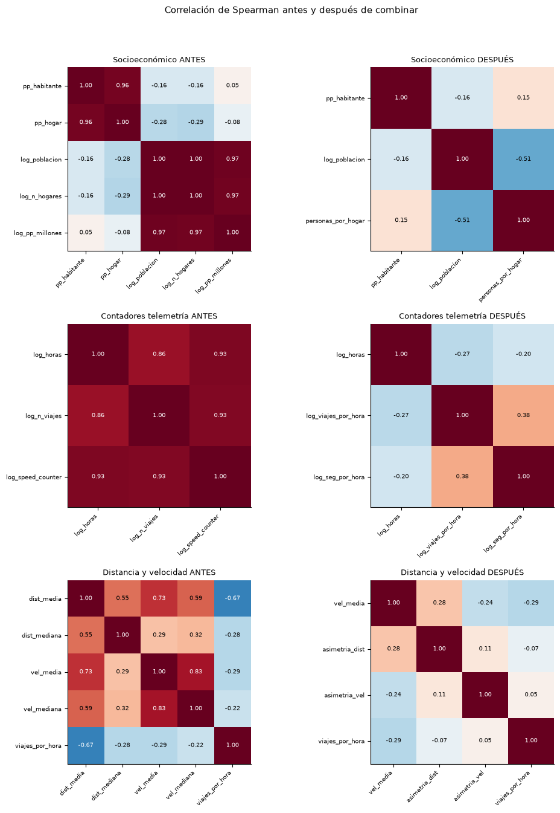

# Cómo hemos tratado las variables muy correlacionadas

## 1. El problema

En el dataset hay 5 columnas con datos socioeconómicos del código postal de cada cliente:

| Columna | Significado |
|---|---|
| `pp_habitante` | Poder adquisitivo por habitante (€) |
| `pp_hogar` | Poder adquisitivo por hogar (€) |
| `población` | Número de habitantes de la zona |
| `n_hogares` | Número de hogares de la zona |
| `pp_millones` | Poder adquisitivo total de la zona (millones de €) |

En la matriz de correlación original aparecen muchos valores **rojos intensos (0,96 – 1,00)** fuera de la diagonal.
Eso significa que **varias columnas dicen prácticamente lo mismo**. Es como tener la temperatura en grados
Celsius y en Fahrenheit: son dos columnas, pero un único dato.

Tener columnas repetidas es un problema porque:

- da más peso del que toca a una misma información;
- confunde a los modelos (no saben a cuál de las dos atribuir el efecto);
- complica la interpretación de los resultados.

## 2. ¿Por qué no simplemente eliminar?

Eliminar una columna de cada pareja es la solución más rápida, pero **se puede perder información** si la columna
eliminada tenía algo propio. Por eso, en vez de borrar, hemos **combinado**: hemos buscado qué dato nuevo aporta
realmente cada columna y nos hemos quedado solo con ese dato.

## 3. Qué hemos descubierto

Al comprobarlo con los datos (fila a fila, en los 158.097 clientes), estas relaciones se cumplen **exactamente**:

| Columna | Se calcula como | ¿Aporta algo nuevo? |
|---|---|---|
| `pp_millones` | `pp_habitante × población` | **No.** Es una multiplicación de dos columnas que ya tenemos. |
| `n_hogares` | `población ÷ personas_por_hogar` | Solo una cosa: **cuántas personas viven por hogar**. |
| `pp_hogar` | `pp_habitante × personas_por_hogar` | Lo mismo: **cuántas personas viven por hogar**. |

Es decir, de las 5 columnas solo salen **3 datos distintos**:

1. **Lo rica que es la zona**, con `pp_habitante`.
2. **Lo grande que es la zona**, con `población`.
3. **Lo grandes que son los hogares**, con `personas_por_hogar` (columna nueva = población ÷ hogares).

## 4. El resultado: 5 columnas → 3 columnas

Que haya menos columnas **no significa que hayamos perdido datos**. A partir de las 3 nuevas se pueden
reconstruir las 5 originales:

- `n_hogares = población ÷ personas_por_hogar`
- `pp_hogar = pp_habitante × personas_por_hogar`
- `pp_millones = pp_habitante × población ÷ 1.000.000`

El error al reconstruirlas es como mucho del **0,07 %**, que se debe solo al redondeo del CSV.
Además, las columnas originales **siguen en el dataset limpio**: solo dejan de usarse en el análisis.

## 5. Cómo leer la nueva matriz

**Los colores indican la dirección de la relación, no si algo está mal:**

| Color | Significado | Ejemplo |
|---|---|---|
| 🟥 Rojo | Cuando una sube, la otra también sube | Población y número de hogares |
| ⬜ Blanco | No tienen relación | Riqueza y tamaño de la zona |
| 🟦 Azul | Cuando una sube, la otra baja | Población y personas por hogar |

**La diagonal siempre vale 1,00**, porque es cada variable comparada consigo misma. No hay que interpretarla.

**Lo que indica un problema es un valor cercano a 1 o a −1 fuera de la diagonal.** Antes había varios (0,96, 0,97,
1,00). Ahora el valor más alto es **−0,51**.

### ¿Y el azul de −0,51?

Es la relación entre `población` y `personas_por_hogar`, y **es un hallazgo real, no un error**:
en las ciudades grandes los hogares son más pequeños (pisos de 1–2 personas) y en zonas pequeñas o rurales
viven más personas por hogar (familias). Es una relación moderada, no una repetición: las dos
columnas aportan información distinta.

## 6. Cómo lo hemos comprobado: el VIF

El **VIF** (factor de inflación de la varianza) mide lo repetida que está una columna respecto a las demás:

- **cerca de 1**: la columna aporta información propia;
- **más de 5**: empieza a estar repetida;
- **más de 10**: está muy repetida (problema grave).

| Bloque | VIF antes | VIF después |
|---|---|---|
| Socioeconómico | **150 – 2.532** | **1,0 – 1,3** |
| Contadores de telemetría | 6,6 – 12 | 1,2 – 2,1 |

Antes había columnas con un VIF de más de 2.500, es decir, completamente repetidas. Ahora todas están cerca de 1.

## 7. Lo mismo con la telemetría

Con los contadores de uso del vehículo pasaba algo parecido: cuantas más **horas** se usa un coche, más
**viajes** y más **registros de velocidad** acumula. Las tres columnas crecían a la vez. Las hemos convertido en
tasas, que sí aportan información nueva:

| Antes | Después | Qué indica |
|---|---|---|
| `operating_hours_total` | se mantiene | Cuánto se usa el coche |
| `trip_distance_all_counter` (n.º de viajes) | `viajes_por_hora` | Trayectos cortos (ciudad) o largos (carretera) |
| `speed_all_counter` (n.º de registros) | `seg_registrados_por_hora` | Calidad o cobertura del registro telemático |

Al hacerlo hemos descubierto una **inconsistencia**: el contador de velocidad registra aproximadamente un dato
por segundo (unos 3.600 por hora), pero el **10,8 %** de las filas con telemetría registra más de 7.200 por hora,
algo imposible. Además, 578 filas superan los 60 viajes por hora. Hay que revisar o acotar estos valores antes de modelar.

## 8. Resumen en una frase

> Hemos pasado de **5 columnas que repetían 3 datos** a **3 columnas con un dato distinto cada una**, sin perder
> información: las originales se pueden reconstruir y siguen guardadas en el dataset limpio.
